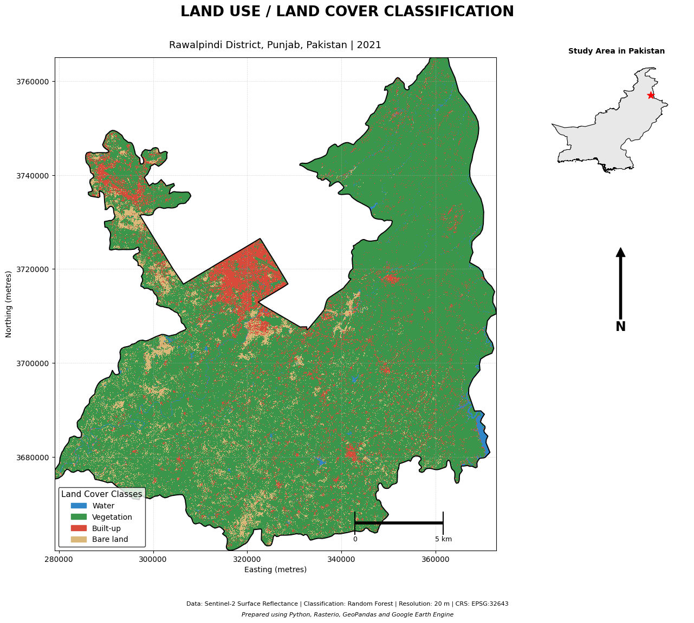

# 🛰️ GeoCover-Rawalpindi-Satellite-Based-Land-Cover-Intelligence
Sentinel-2 based land-use and land-cover classification of Rawalpindi District, Pakistan, using Random Forest, Google Earth Engine, Python, Scikit-learn, GeoPandas, Rasterio and spectral indices (NDVI, NDWI and NDBI).


[](https://www.python.org/)
[](https://earthengine.google.com/)
[](https://scikit-learn.org/)
[](#data-and-methodology)

A geospatial machine learning project for satellite-based land-use and land-cover classification of Rawalpindi District, Punjab, Pakistan, using Sentinel-2 imagery, spectral indices, Google Earth Engine, and Python.

---

## 📑 Table of Contents

- [Project Overview](#project-overview)
- [Study Area](#study-area)
- [Objectives](#objectives)
- [Data and Methodology](#data-and-methodology)
- [Land-Cover Classes](#land-cover-classes)
- [Tools and Technologies](#tools-and-technologies)
- [Project Workflow](#project-workflow)
- [Results and Visualization](#results-and-visualization)
- [Model Evaluation](#model-evaluation)
- [Repository Structure](#repository-structure)
- [Data Availability](#data-availability)
- [Author](#author)

## 🌍 Project Overview

This project presents a satellite-based land-use and land-cover (LULC) classification of Rawalpindi District, Punjab, Pakistan, for 2021.

The workflow integrates Sentinel-2 Surface Reflectance Harmonized imagery, spectral indices, and machine learning to classify four major land-cover categories: water, vegetation, built-up areas, and bare land.

A Random Forest classifier is implemented using Python and Google Earth Engine. ESA WorldCover v200 provides the reference labels used for model training and evaluation.

The project demonstrates an integrated geospatial workflow covering satellite image processing, feature extraction, supervised classification, accuracy assessment, feature importance analysis, and cartographic visualization.

## 📍 Study Area

- **Location:** Rawalpindi District, Punjab, Pakistan
- **Reference year:** 2021
- **Coordinate reference system:** WGS 84 / UTM Zone 43N (EPSG:32643)
- **Output spatial resolution:** 20 metres

## 🎯 Objectives

- Develop a land-cover classification using Sentinel-2 satellite imagery.
- Extract spectral bands and indices to improve land-cover discrimination.
- Implement Random Forest classification using Python and Google Earth Engine.
- Evaluate classification performance using confusion matrices and class-wise metrics.
- Examine the contribution of spectral features through feature importance analysis.
- Produce a professional land-cover map of the study area.

## 🛰️ Data and Methodology

| Component | Description |
|---|---|
| Satellite imagery | Sentinel-2 Surface Reflectance Harmonized |
| Reference labels | ESA WorldCover v200 |
| Study year | 2021 |
| Output resolution | 20 metres |
| Classification algorithm | Random Forest |
| Processing environment | Google Earth Engine and Python |

### Spectral Features

**Spectral bands:**
- Blue (B2)
- Green (B3)
- Red (B4)
- Near Infrared (B8)
- Shortwave Infrared (B11)
- Shortwave Infrared (B12)

**Derived spectral indices:**
- NDVI – Normalized Difference Vegetation Index
- NDWI – Normalized Difference Water Index
- NDBI – Normalized Difference Built-up Index

## 🌱 Land-Cover Classes

| Code | Class | Description |

|---|---|---|
| 0 | Water | Permanent water bodies |
| 1 | Vegetation | Grouped vegetation and agricultural cover |
| 2 | Built-up | Urban and built-up surfaces |
| 3 | Bare land | Bare and sparsely vegetated surfaces |

## ⚙️ Tools and Technologies

| Tool / Library | Application |
|---|---|
| Google Earth Engine | Satellite data processing |
| Python | Geospatial analysis and machine learning |
| Google Colab | Cloud-based development |
| Scikit-learn | Random Forest classification and evaluation |
| GeoPandas | Vector data processing |
| Rasterio | Raster processing and analysis |
| Geemap | Earth Engine–Python integration |
| NumPy | Numerical operations |
| Pandas | Data management and analysis |
| Matplotlib | Visualization and cartography |

## 🔄 Project Workflow

1. **Data acquisition:** Retrieve Sentinel-2 imagery and ESA WorldCover reference data.
2. **Pre-processing:** Prepare satellite imagery and study-area boundaries.
3. **Feature extraction:** Select spectral bands and calculate NDVI, NDWI, and NDBI.
4. **Training data preparation:** Generate model training samples using reference labels.
5. **Model development:** Train and apply the Random Forest classifier.
6. **Accuracy assessment:** Generate confusion matrices and classification metrics.
7. **Feature analysis:** Examine the importance of individual spectral features.
8. **Cartographic visualization:** Produce the final classified land-cover map.

## 🗺️ Results and Visualization

### Final Land-Cover Map

The final map illustrates the spatial distribution of the four land-cover categories across Rawalpindi District.



*Figure 1. Sentinel-2 based land-cover classification of Rawalpindi District, 2021.*

### Analytical Outputs

The repository includes:

- Final classified land-cover map (PNG and PDF)
- Confusion matrix (PNG and CSV)
- Classification report
- Class-wise accuracy assessment
- Feature importance analysis (PNG and CSV)
- Overall model performance metrics

## 📊 Model Evaluation

Classification performance is assessed using:

- Overall Accuracy (OA)
- Cohen's Kappa
- Precision
- Recall
- F1-score
- Confusion Matrix

**Validation note:** ESA WorldCover v200 was used as the reference-label source. Therefore, the reported metrics represent agreement with these reference labels and should not be interpreted as independent field-based validation or ground-truth accuracy.

## 📁 Repository Structure

```text
geocover-rawalpindi/
│
├── README.md
├── notebooks/
│   └── GeoCover_Rawalpindi_Final.ipynb
├── maps/
│   ├── Rawalpindi_Land_Cover_Map_2021.png
│   └── Rawalpindi_Land_Cover_Map_2021.pdf
├── results/
│   ├── confusion_matrix.png
│   ├── confusion_matrix.csv
│   ├── classification_report.csv
|   ├── Earth_Engine_Accuracy.csv
│   ├── feature_importance.png
│   ├── feature_importance.csv
│   └── Overall_Accuracy_Metrics.csv
├── data/
    └── README.md
```

*This is the intended organization. The actual files in the repository may differ.*

## 📂 Data Availability

The Jupyter Notebook, final maps, and analytical results are provided in this repository for project review and reference.

The classified GeoTIFF raster is not publicly distributed. Original satellite and reference datasets can be accessed through their respective data providers:

- [Copernicus Data Space](https://dataspace.copernicus.eu/)
- [ESA WorldCover](https://worldcover2021.esa.int/)
- [Google Earth Engine](https://earthengine.google.com/)

## 👩‍💻 Author

**Qureshi Kinza **

---

## 📜 License

No reuse license has been assigned yet. Please contact the author before reusing or redistributing project materials.

---

*Part of a geospatial and environmental data science portfolio.*
